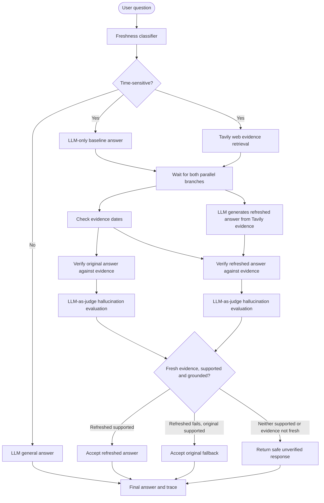

# Multi-Agent Freshness Research Agent

A Streamlit research workflow that compares an LLM-only baseline answer with a refreshed answer generated from Tavily web evidence. For time-sensitive queries, the baseline LLM call and Tavily retrieval run concurrently. The refreshed LLM answer is then generated from the retrieved evidence, both candidates are independently verified, and the coordinator selects a final answer.

## Setup (PowerShell)

```powershell
python -m venv .venv
.\.venv\Scripts\Activate.ps1
pip install -r requirements.txt
copy .env.example .env
```

Set `BIFROST_BASE_URL`, `BIFROST_API_KEY`, `BIFROST_MODEL`, and `TAVILY_API_KEY` in `.env`. The hallucination evaluator uses ordinary OSS Bifrost chat completions; no licensed guardrail configuration is needed.

## Run

```powershell
streamlit run app.py
```

## Workflow



### Answer meanings

- **Original answer:** Generated by the LLM from its pretrained knowledge, without Tavily evidence. It is a baseline and may be outdated.
- **Refreshed answer:** Generated by the LLM using Tavily's retrieved web evidence. Tavily retrieves evidence; it does not write this answer.
- **Final answer:** The coordinator's selected answer after freshness and claim-verification gates.

### Selection rules

1. Fresh evidence + refreshed answer supported → accept refreshed answer.
2. Fresh evidence + refreshed answer not supported + original answer supported → accept original as a fallback.
3. Evidence not fresh, or neither answer supported → return a safe message that current information could not be verified.
4. Static/general query → generate and return one LLM answer; no Tavily search is required.

## Freshness configuration

- `TAVILY_TIME_RANGE=day|week|month|year` (default `month`). This is a Tavily search filter, not proof that the returned evidence is fresh.
- `FRESHNESS_MAX_AGE_DAYS` controls the publication-date threshold (default 30).
- Sources without parseable publication dates are not counted as dated evidence.


## Hallucination detection with OSS Bifrost (no licensed guardrails)

The project implements hallucination detection as an **application-level LLM-as-judge agent** in `agents/hallucination_agent.py`. The judge uses the regular OpenAI-compatible chat-completions endpoint exposed by OSS Bifrost. It does not send `x-bf-guardrail-id`, call Enterprise guardrail APIs, or require Patronus credentials/a license.

For each time-sensitive query:

1. The original LLM-only answer and Tavily evidence retrieval run in parallel.
2. The refreshed answer is generated by the LLM using Tavily evidence.
3. The claim verification agent checks each answer against evidence.
4. The hallucination evaluator independently checks for contradicted claims, unsupported details, fabricated citations, and invented specifics.
5. The coordinator accepts a candidate only when evidence is fresh, claim verification says `supported`, and the hallucination judge has not found a material contradiction or fabricated citation. `unsupported_claims` is not itself proof of hallucination; the independent claim-verification gate remains responsible for support.

### Hallucination evaluation statuses

- `grounded`: material claims are supported by supplied evidence.
- `likely_hallucination`: at least one material claim is contradicted by evidence or a citation is fabricated/misrepresented.
- `unsupported_claims`: evidence does not substantiate one or more claims. This is a warning/status distinct from a proven contradiction; the candidate still must pass the separate claim-verification gate.
- `unverifiable`: there is no useful independent evidence or the evidence cannot decide.

The original answer is generated without retrieval, but is evaluated afterward against the same Tavily evidence as the refreshed answer. This allows an apples-to-apples grounding comparison. For static queries or when Tavily returns no results, the evaluator reports `unverifiable`; an LLM cannot prove its own factual correctness from its pretrained knowledge alone.

### Configuration

Only the normal OSS Bifrost settings are required:

```dotenv
BIFROST_BASE_URL=http://localhost:8080/v1
BIFROST_API_KEY=your-key
BIFROST_MODEL=openai/gpt-4o-mini
TAVILY_API_KEY=your-tavily-key
```

No Bifrost guardrail ID, Patronus profile, or licensed feature is required. The quality of the LLM-as-judge depends on the selected model and the quality/coverage of the supplied evidence. Treat the judge as an independent evaluation signal, not mathematical proof of truth.

## Trace history

Agent spans and run history are stored in SQLite (`TRACE_DB_PATH` can override the default). Existing databases are migrated by adding missing columns rather than dropping saved history.

## Limitations

Publication dates can be absent or inaccurate, search results can be incomplete, and LLM verification is not proof of correctness. For high-impact decisions, confirm important claims with authoritative primary sources.
