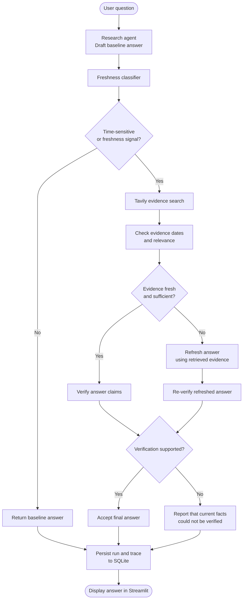

# Multi-Agent Freshness Research Agent

A Streamlit research workflow with a freshness classifier, Tavily evidence retrieval, claim verification, evidence-grounded refresh, re-verification, trace spans, and SQLite run history.

## Setup (PowerShell)
```powershell
python -m venv .venv
.\.venv\Scripts\Activate.ps1
pip install -r requirements.txt
copy .env.example .env
```
Set `BIFROST_BASE_URL`, `BIFROST_API_KEY`, `BIFROST_MODEL`, and `TAVILY_API_KEY` in `.env`.

## Run
```powershell
streamlit run app.py
```

## Workflow flowchart

The diagram below shows the coordinator's freshness-checking path. Time-sensitive questions are routed to evidence retrieval; stale or insufficient evidence triggers a refresh, and the refreshed answer must pass re-verification before it is accepted.



## Freshness behavior
- Queries with explicit time-sensitive wording are forced through web search even if the LLM classifier says otherwise.
- Tavily can be constrained using `TAVILY_TIME_RANGE=day|week|month|year` (default `month`).
- `FRESHNESS_MAX_AGE_DAYS` sets the default publication-date threshold (default 30).
- Stale or undated evidence is not treated as verified current evidence.
- A refreshed answer is accepted only when its evidence passes the freshness gate and re-verification returns `supported`; otherwise the app reports that current information could not be verified.

## SQLite traces
Trace history is stored in `traces.db` (or `TRACE_DB_PATH`). The schema migration adds missing columns to existing `spans` tables without deleting prior history.

## Limitations
Publication dates can be absent or inaccurate, and LLM verification is not a proof of correctness. For high-impact decisions, confirm important claims with authoritative primary sources.
