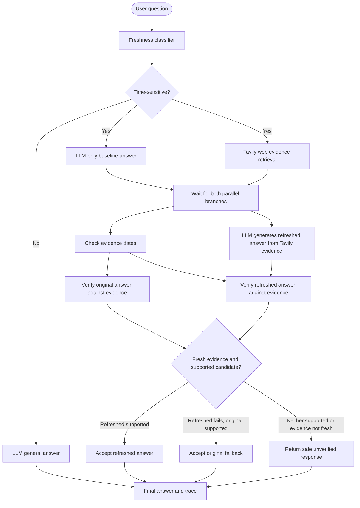

# Multi-Agent Freshness Research Agent

A Streamlit research workflow that compares an LLM-only baseline answer with a refreshed answer generated from Tavily web evidence. For time-sensitive queries, the baseline LLM call and Tavily retrieval run concurrently. The refreshed LLM answer is then generated from the retrieved evidence, both candidates are independently verified, and the coordinator selects a final answer.

## Setup (PowerShell)

```powershell
python -m venv .venv
.\.venv\Scripts\Activate.ps1
pip install -r requirements.txt
copy .env.example .env
```

Set `BIFROST_BASE_URL`, `BIFROST_API_KEY`, `BIFROST_MODEL`, and `TAVILY_API_KEY` in `.env`.

## Run

```powershell
streamlit run app.py
```

## Workflow



### Answer meanings

- **Original answer:** Generated by the LLM from its pretrained knowledge, without Tavily evidence. It is a baseline and may be outdated.
- **Refreshed answer:** Generated by the LLM using Tavily's retrieved web evidence. Tavily retrieves evidence; it does not write this answer.
- **Final answer:** The coordinator's selected answer after freshness and claim-verification gates.

### Selection rules

1. Fresh evidence + refreshed answer supported → accept refreshed answer.
2. Fresh evidence + refreshed answer not supported + original answer supported → accept original as a fallback.
3. Evidence not fresh, or neither answer supported → return a safe message that current information could not be verified.
4. Static/general query → generate and return one LLM answer; no Tavily search is required.

## Freshness configuration

- `TAVILY_TIME_RANGE=day|week|month|year` (default `month`). This is a Tavily search filter, not proof that the returned evidence is fresh.
- `FRESHNESS_MAX_AGE_DAYS` controls the publication-date threshold (default 30).
- Sources without parseable publication dates are not counted as dated evidence.

## Trace history

Agent spans and run history are stored in SQLite (`TRACE_DB_PATH` can override the default). Existing databases are migrated by adding missing columns rather than dropping saved history.

## Limitations

Publication dates can be absent or inaccurate, search results can be incomplete, and LLM verification is not proof of correctness. For high-impact decisions, confirm important claims with authoritative primary sources.
